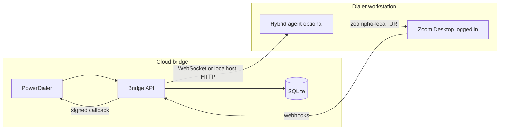

# Zoom Phone Bridge — API Research (Part D)

Last updated: 2026-05-18. This document answers the mandatory research questions for the Power Dialer Zoom Phone Bridge. Official references are linked; verify against your Zoom account tier before production.

## Executive summary

| Capability | Finding | Bridge approach |
|------------|---------|-----------------|
| Server-initiated outbound PSTN | **No public REST “place call”** in the main [Phone API reference](https://developers.zoom.us/docs/api/phone/); `call_logs` / `call_history` are **read/sync** endpoints | **`mock`**: simulated lifecycle for demos/tests; **`api`**: OAuth + webhooks + optional future call-control endpoints when enabled on account; **`hybrid`**: local Zoom desktop + URI / agent helper |
| Auto-answer bridge leg | **Not documented** for outbound REST; forum threads indicate answer APIs target **inbound/active** legs with Marketplace call-control policy | Do not rely on `POST /phone/calls/{id}/answer` until verified on your account; use hybrid if bridge user desktop must not ring |
| Attended transfer | Policy supports warm/blind transfer in client; REST transfer endpoints are **not** in the published Phone API index we reviewed | Prefer blind transfer API if available on account; else two-leg workaround (bridge user + transfer to agent extension) |
| SMS send | Requires Zoom Phone SMS license; settings at `GET /phone/users/{userId}/settings` → `sms.enable` | Bridge returns **501** when disabled; implement `POST` SMS when licensed (see SMS section) |
| AMD / voicemail drop | **No native AMD** on Zoom Phone PSTN | Treat all answers as human; set `voicemailDropSupported: false` |
| Contact Center | Separate product/API | **Out of scope** — see [Why not Contact Center](#why-not-zoom-contact-center) |

---

## 1. Outbound call initiation

### What the official docs say

- [Integrate with Zoom Phone](https://developers.zoom.us/docs/phone/integrate-with-zoom-phone/) recommends **URI schemes** (`zoomphonecall`, `tel`, `callto`) to launch the Zoom client and place calls; webhooks track status.
- [Initiate an outbound call](https://developers.zoom.us/docs/phone/outbound-call/) documents `zoomphonecall://{number}?callerid={e164}` with **autodial** when the desktop client is logged in.
- Account policy: `auto_call_from_third_party_apps` — “perform call control actions from authorized Zoom Marketplace apps” ([Phone API settings](https://developers.zoom.us/docs/api/phone/)).

### `POST /phone/users/{userId}/call_logs` (spec assumption)

**Incorrect for placement.** In the API reference, `/phone/users/{userId}/call_logs` is **GET** (list, deprecated) — not create. Call logs are produced **after** calls complete.

### Practical initiation options

1. **URI / desktop (documented)** — `zoomphonecall://+1…` — requires logged-in Zoom app (hybrid or agent machine).
2. **Marketplace call control (account-dependent)** — Some accounts expose call-control APIs when the app is authorized and `auto_call_from_third_party_apps` is enabled; endpoint names vary by release — validate in [API reference](https://developers.zoom.us/docs/api/rest/reference/phone/methods/) and Postman collection.
3. **Bridge `mock` mode** — Deterministic simulated `call_id` for Power Dialer progressive dial testing without Zoom.

### Required OAuth scopes (typical)

- `phone:read:admin`, `phone:write:admin` (account-level Server-to-Server OAuth)
- Granular: `phone:read:list_call_logs:admin`, webhook subscription scopes
- User settings: `phone:read:user:admin` or `phone:read:settings:admin`

Links: [OAuth scopes](https://developers.zoom.us/docs/integrations/oauth-scopes-overview/), [Using Zoom APIs](https://developers.zoom.us/docs/api/using-zoom-apis/).

---

## 2. Auto-answer capability

### Question

Can `POST /phone/calls/{callId}/answer` be used on an **outbound** ringing leg for the bridge user?

### Finding

- Public Phone API reference (May 2026 scrape) does **not** list `/phone/calls/{callId}/answer` alongside admin CRUD endpoints.
- [Developer forum](https://devforum.zoom.us/t/zoom-phone-answer-the-call-api/129754): answer/control is discussed in the context of **active calls** and client/call-control integrations, not headless outbound PSTN origination.
- **Conclusion:** Treat server-side auto-answer as **unverified / likely unavailable** for headless progressive dial. **Recommendation:** hybrid architecture (dedicated bridge Zoom user workstation with auto-answer) or agent-assisted fallback.

---

## 3. Attended transfer (agent connect after PSTN answer)

### Finding

- Zoom Phone supports **warm and blind** transfer in product policy (`call_transferring`).
- REST methods for `POST /phone/calls/{callId}/transfer` are **not** present in the published Phone API index reviewed; Contact Center uses separate command APIs.

### Workarounds

1. **Blind transfer** to agent extension/user ID if call-control API exists on your account.
2. **Two-leg:** bridge user stays on call → dial agent via URI → conference/transfer in client.
3. **`callType=agent`:** bridge rings agent Zoom user via internal extension transfer when API available.

---

## 4. Webhook events

Docs: [Phone webhooks](https://developers.zoom.us/docs/phone/webhooks/).

### Subscription

- Create/update subscription via Phone webhook APIs (account-level) or Zoom Marketplace event subscriptions.
- Validation: Zoom sends `validationToken`; endpoint must echo token (plain text).
- Security: `x-zm-signature` HMAC-SHA256 with webhook secret.

### Events (bridge listens)

| Event | Power Dialer disposition |
|-------|--------------------------|
| `phone.call_ringing` | `RINGING` |
| `phone.call_answered` | `IN_PROGRESS` |
| `phone.call_completed` (normal, duration > 0) | `COMPLETED` |
| `phone.call_completed` (busy) | `BUSY` |
| `phone.call_completed` (no answer) | `NO_ANSWER` |
| `phone.call_canceled` | `CANCELED` |
| `phone.call_fail` | `FAILED` |
| `phone.sms_sent` | `SENT` |
| `phone.sms_delivered` | `DELIVERED` |
| `phone.sms_failed` | `FAILED` |
| `phone.recording_completed` | Update `recordingUrl` only |

**Gotchas:** Multiple events per `call_id`; `call_id` may appear in nested payload; dedupe on `event_ts` + `call_id`. Recording often arrives **after** terminal call event.

---

## 5. SMS API

### Settings check

`GET /phone/users/{userId}/settings` — inspect `sms.enable` (and `international_sms` if needed).

### Send

Zoom Phone SMS REST paths are account/feature gated; common pattern (verify on your account):

- `POST /phone/users/{userId}/sms` or session-based SMS APIs in newer releases.

### Limitations

- Requires Zoom Phone **calling plan + SMS-capable number** per user.
- Regional / international SMS controlled by policy (`international_sms`, `international_sms_countries`).
- Rate limits: [REST rate limits](https://developers.zoom.us/docs/api/rest/rate-limits/) — label varies by endpoint (`LIGHT` / `MEDIUM`).

If SMS API unavailable → bridge returns **501** with clear message.

---

## 6. Voicemail / AMD

- Zoom Phone **does not** expose answering-machine detection for PSTN in public APIs.
- Voicemail is a **call result** (`voicemail` in call history), not AMD for outbound campaigns.
- **Bridge behavior:** never auto-drop on machine; `voicemailDropSupported: false` in callbacks when `voicemailDropEnabled` was requested.

---

## 7. Recording API

| Item | Detail |
|------|--------|
| List | `GET /phone/recordings`, `GET /phone/users/{userId}/recordings` |
| Detail | `GET /phone/recordings/{recordingId}` |
| Download | `GET /phone/recording/download/{fileId}` |
| Transcript | `GET /phone/recording_transcript/download/{recordingId}` |
| Webhook | `phone.recording_completed` includes recording metadata |

**Auth:** OAuth bearer; download URLs may be **time-limited** — persist `recordingId` and refresh download link on demand.

**Bridge:** Forward `recordingUrl` in callback when webhook provides it; Power Dialer updates attempt without re-dialing.

---

## 8. Known limits

| Limit | Notes |
|-------|--------|
| Concurrent calls | Per Zoom Phone user license; no hard public number — plan for **1 progressive call** per campaign in Power Dialer |
| Rate limits | Endpoint-specific ([rate limits](https://developers.zoom.us/docs/api/rest/rate-limits/)) |
| Geography | Outbound calling rules per user/site (`outbound_calling`, blocked lists) |
| Third-party apps | Admin must enable `auto_call_from_third_party_apps` |

---

## 9. Hybrid architecture (recommended when REST origination unavailable)

### Requirements

- Windows/Mac mini with Zoom Phone desktop, **logged in** as `ZOOM_DEFAULT_USER_ID`
- Admin: enable **Automatically call from 3rd party apps**
- Optional: auto-answer incoming (bridge user leg)
- Hybrid agent: small local service receives dial jobs, runs `open "zoomphonecall://…"` or Zoom CLI `Zoom --url=…`

### Tradeoffs

| | Cloud-only REST | Hybrid |
|--|-----------------|--------|
| Scalability | High if API exists | One (few) workstations |
| Maintenance | Low | OS + Zoom client updates |
| Progressive auto-dial | Needs call-control API | Works with URI + webhooks |
| Contact Center cost | Avoided | Avoided |

---

## 10. Why not Zoom Contact Center

- Separate **[Contact Center APIs](https://developers.zoom.us/docs/contact-center/)** and licensing (often per-seat CCaaS pricing).
- Predictive/preview dialer models differ from Power Dialer’s **one live call per campaign** progressive model.
- Power Dialer goal: **budget-friendly** Zoom Phone + bridge, not full CC platform migration.

---

## Implementation decision for this repo

1. Ship bridge with **`ZOOM_BRIDGE_MODE=mock|api`** (`mock` default for local demo).
2. **`api` mode:** OAuth health check + webhook ingestion + best-effort call/SMS methods; log clearly when origination fails.
3. Document **hybrid** in [SETUP.md](../services/zoom-phone-bridge/SETUP.md) for production Zoom accounts without call-control REST.
4. Power Dialer: bridge health gates auto-dial; agent `zoomphonecall://` fallback when bridge unhealthy.
